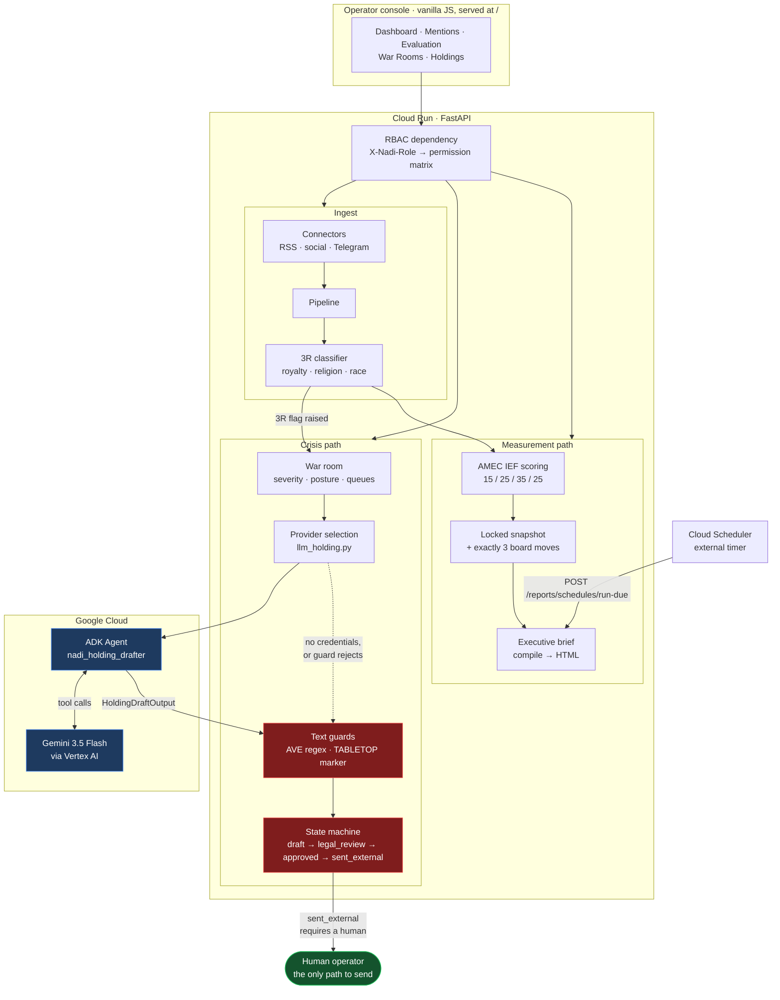
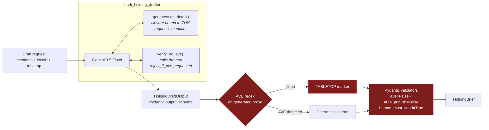

# Architecture

The Escalate is a FastAPI service on Cloud Run that serves both its API and its
operator console from one origin. The interesting part is not the request path —
it is where the **guards** sit relative to the agent.

## System diagram



## The agent, in detail

The holding-statement drafter is a real `google.adk.agents.Agent`, not a single
`generate_content` call. Two things make it worth the extra machinery:



**Tools are scoped, not global.** `get_mention_detail` is a closure built per
request, bound to exactly the mentions in that drafting session. The agent
cannot look up a mention belonging to another war room, another workspace, or
another tenant, because those objects are not in the closure. Isolation is a
property of construction rather than a rule the model is asked to follow.

**`verify_no_ave` calls the production function.** It invokes the same
`reject_if_ave_requested` used by the HTTP layer — not a reimplementation — so
the tool and the API can never drift apart.

**The output schema constrains generation.** `HoldingDraftOutput` is passed as
ADK's `output_schema`, so the model is constrained at decode time rather than
producing free text that is parsed and hoped over.

## Why the guards sit outside the agent

Every provider path — ADK, Vertex AI, direct Gemini, OpenAI, deterministic —
converges on one guard implementation before a `HoldingBrief` exists.

This was not always true, and the failure is instructive. The ADK branch
originally returned its brief directly, which skipped the shared guards. Because
ADK is the *highest-priority* provider, the path most likely to run in a
credentialed deployment was the one path with no AVE scan of the model's own
prose and no `[TABLETOP — DO NOT SEND]` marker — meaning a training drill could
return a draft indistinguishable from a sendable statement. It also dropped
`do_not_say` and `ops`, so the best path produced weaker safety guidance than
the fallback it outranked.

The lesson generalised: **a guard that lives on one branch is not a guard.**
`tests/test_adk_guards.py` now pins this shape, including the case where the
model emits AVE language and the system must discard it and fall back to a safe
draft rather than pass it through.

## Defence in depth on the send gate

Four independent layers must all fail for a statement to publish itself:

| Layer | Mechanism |
|-------|-----------|
| Prompt | System prompt forbids AVE and auto-publish |
| Tool | `verify_no_ave` lets the agent check before finalising |
| Post-process | Regex scan + hardcoded field assignment, ignoring model output |
| Model | Pydantic `field_validator`s coerce `ave`/`auto_publish` to `False` and `human_must_send` to `True` regardless of input |

Plus the state machine: `sent_external` is reachable only from `approved`, and
only by an explicit transition request from a role holding the permission.
There is no code path that advances that state on its own.

## Data isolation

`org_id` is on every row. `schemas/migrations/001_initial_schema_and_rls.sql`
defines Postgres row-level security policies so isolation is enforced by the
database, not only by application queries. The RBAC matrix in
`domain/rbac.py` gates the six roles against named permissions
(`ws.reports.run`, `ws.brief.run`, …), checked by a FastAPI dependency on every
route rather than ad hoc inside handlers.

## Deployment

```
gcloud run deploy --source .
        │
        ├── Cloud Build builds the image remotely (no local Docker)
        ├── Container: python:3.12-slim, uvicorn binding $PORT
        ├── Serves API + console on one origin
        └── ADC → Vertex AI (service account needs Vertex AI User)
```

Scale-to-zero (`--min-instances 0`) is deliberate: a PR desk's crisis tooling is
idle most of the time, and the state that matters belongs in Postgres rather
than in a warm container.
